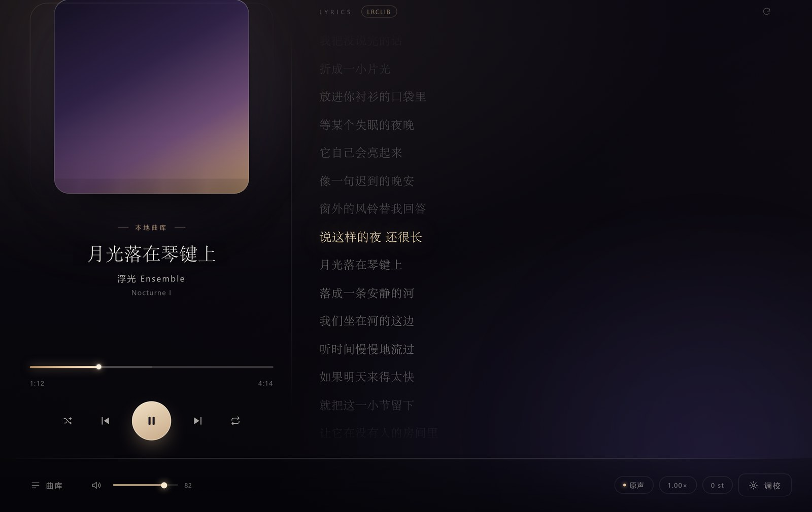
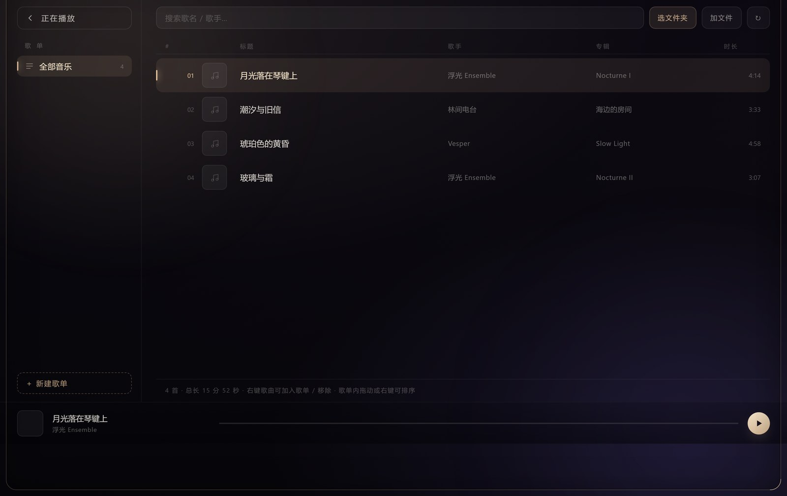

# Luvsic


> **只支持 Windows 10/11 与 Android 8.0+。**
> macOS、Linux、iOS 不提供支持。

一台听**本地音乐**的桌面播放器。深色、暗金、玻璃质感，启动有一段仪式感的加载动画。

用 Python + 本地 HTTP 服务 + Web Audio 搭起来，界面跑在 Edge 应用模式（Chromium 内核）里。




---

## 📱💻 可选：手机和电脑互通

**默认是纯本地播放器，不需要任何账号。**

想跨设备同步？用**你自己的** GitHub 仓库当后端——数据归你，不经过任何服务器，也不依赖本项目作者的仓库。

▶ **[搭建自己的同步仓库（5 分钟教程）](docs/SYNC-SETUP.md)**

配好之后是这样的效果：

手机版和电脑版登录**同一个账号**（8 位账号 ID + 邀请码），曲库、歌单、好友、听歌时长实时同步到同一个 GitHub 仓库。

| 你在手机上做的事 | 电脑上会看到 |
|---|---|
| 新增一个歌单 | 歌单立刻出现，曲目路径自动映射成本机文件 |
| 把歌加进歌单 | 电脑端标记「离线」，本机有同一首就直接可播 |
| 听了 2 小时 | 排行榜时长 +2h，两台设备的统计自动合并去重 |
| 正在播放某首歌 | 「正在播放」显示在那台设备上 |

| 你在电脑上做的事 | 手机上会看到 |
|---|---|
| 整理曲库、改歌手名 | 同步后手机曲库跟着变 |
| 新建歌单 | 手机端一键导入 |
| 分享歌单给好友 | 对方在「好友与排行」页收到，可一键导入 |

**同步内容**：曲库索引、歌单、好友列表、听歌统计、正在播放状态。

**同步方式**：数据存在你自己的 GitHub 仓库里（Contents API），不经过任何第三方服务器。删除用 tombstone 记录，多设备合并时不会互相覆盖。

**登录方式**：8 位账号 ID + 可选密码；或粘贴邀请码（内含仓库地址与令牌的 Base64 打包）。

**令牌只存在本机** `data/` 目录，不会写进代码，也不会随仓库分发。

---


---

## ⬇️ 下载安装（不用装 Python）

到 [Releases](https://github.com/Luvsic1132/luvsic/releases) 下载：

| 平台 | 文件 | 怎么用 |
|---|---|---|
| **Windows 10/11** | `Luvsic-Windows-v1.28.3.zip` | 解压到任意目录 → 双击 `Luvsic.exe` |
| **Android 8.0+** | `Luvsic-Android-v1.28.3.apk` | 直接安装（包名 `com.luvsic.app`，v2+v3 签名） |

### 打开就是本地模式，没有登录步骤

Luvsic **不会**在启动时拦你登录。打开直接进主界面，播放、曲库、歌词、EQ、变调、壁纸、备份恢复全部可用。

想要跨设备同步，去 **设置 → 账号与同步 → 连接自己的仓库…**，填你自己的 GitHub 仓库和 Token。

▶ **[怎么建这个仓库](docs/SYNC-SETUP.md)**

## 功能总览

### 🎵 播放

| 功能 | 说明 |
|---|---|
| **格式支持** | mp3 / flac / m4a / wav / ogg / opus / aac / wma / ape / aiff / dsf |
| **自动补歌词** | 播歌时自动联网找同步歌词，逐行滚动、当前行高亮、点歌词跳转。优先 LRCLIB（命中率最高），找不到用网易云兜底。结果缓存，同一首歌不再联网 |
| **变速不变调** | 0.5× – 2.0×，Chromium 原生 `preservesPitch` |
| **升降调** | ±12 半音，**独立于速度**，双延迟线粒化算法实时变调 |
| **三频 EQ** | 低频 / 中频 / 高频，5 个预设（原声 / 温暖 / 清澈 / 深夜 / 人声），可拖成自定义，右侧实时曲线 |
| **立体声宽度** | 中/侧分离处理，从「单声道感」到「极宽」 |
| **音量** | 底部滑杆 + 封面滚轮调节 + `M` 静音 |
| **循环** | 列表循环 / 单曲循环 / 随机 |
| **定时停止** | 「播完 N 首后停」或「N 分钟后停」 |
| **其它** | 缓冲进度、渐隐切换、频谱可视化、迷你模式 |

### 📚 曲库



| 功能 | 说明 |
|---|---|
| **扫描导入** | 选一个文件夹，自动扫描音频文件并记住；下次启动自动载入 |
| **歌单** | 新建 / 重命名 / 排序 / 删除，拖拽排序 |
| **批量操作** | 多选、右键菜单、批量加入歌单 |
| **元数据** | 读文件内嵌标签；文件名规范成「歌手 - 歌名」也能识别 |
| **封面** | 读内嵌封面，或同目录 `cover.jpg` / `folder.jpg`，都没有用配色渐变兜底 |
| **导出** | 歌单导出为 `.m3u` |
| **微信音乐扫描** | 自动定位微信/QQ 的本地音乐缓存并导入 |
| **离线标记** | 同步来的歌单里，本机没有的曲目保留条目并标「离线」，不会静默丢失 |

### ☁️ 云同步（可选）· 用自己的 GitHub 仓库

用 GitHub 仓库作为同步后端，把你的曲库索引、歌单、好友、听歌统计存在自己的仓库里。

| 功能 | 说明 |
|---|---|
| **仓库后端** | 基于 GitHub Contents API（`/repos/{owner}/{repo}/contents/{path}`） |
| **同步内容** | 曲库索引、歌单、好友列表、听歌统计、正在播放状态 |
| **多设备** | 设备间合并策略：以曲目稳定 key 去重，删除用 tombstone 记录，不会互相覆盖 |
| **邀请码** | 把「仓库 + 令牌」打包成一串 Base64 邀请码，发给朋友即可加入同一个同步空间 |
| **引擎** | 基于 GitHub Contents API（`/repos/{owner}/{repo}/contents/{path}`），新建与更新统一用 PUT |

> 同步令牌只保存在本机 `data/` 目录，**不会写进代码，也不会随仓库分发**。

### 👥 社交

| 功能 | 说明 |
|---|---|
| **好友** | 通过邀请码加入同一个同步空间，互相可见 |
| **排行榜** | 听歌时长统计，按设备合并去重 |
| **歌单分享** | 歌单右键「分享给好友」，对方在「好友与排行」页收到并一键导入 |
| **正在播放** | 好友可见你当前在听什么 |

### 🎨 界面

- 深色 + 暗金 + 玻璃拟态，衬线排版
- 启动动画层
- 壁纸：可固定单张，也可在设置里任选本机任意图片
- 全屏曲库视图、悬浮歌词面板

### 🛠 其它

| 功能 | 说明 |
|---|---|
| **备份 / 恢复** | 一键导出 `.zip`（配置 + 曲库 + 歌单 + 歌词缓存），换机后导入恢复 |
| **更新检查** | 从同步仓库读取 `updates.json`，支持分片下载 + SHA256 校验 |
| **AI 助手位** | 预留的侧边入口（可自行接入） |

---

## 快速开始

### 系统要求

| 平台 | 要求 |
|---|---|
| **Windows** | Windows 10 / 11（内置 Microsoft Edge，用它承载界面）；Python 3.10+ |
| **Android** | Android 8.0（API 26）及以上 |
| macOS / Linux / iOS | **不支持** |


```
1. 安装 Python 3.10+
2. 双击 `desktop/启动 Luvsic.bat`
   （或手动：`python desktop/main.py`）
3. 首次打开是空的 → 点左下角「曲库」→ 选文件夹
4. 会自动扫描并记住，下次打开自动载入
5. **不需要登录**，直接就能用
```

**依赖**：仅标准库。界面用系统自带的 Microsoft Edge（Windows 10/11 内置）承载，不需要额外安装浏览器。

**改 Python 路径**：如果 `启动 Luvsic.bat` 里的 Python 路径和你机器不一致，改那一行即可。

---

## 两个平台

同一个仓库包含桌面版与安卓版，共用一套前端 `ui/`。

```
├── desktop/            桌面版宿主
│   ├── main.py         Python：本地 HTTP 服务（Range 请求）+ 后端 API + 窗口控制
│   └── 启动 Luvsic.bat
├── android/            安卓版
│   ├── AndroidManifest.xml
│   ├── build.ps1        无 Gradle 构建脚本（aapt2 + javac + d8 + zipalign + apksigner）
│   ├── pack_apk.py
│   ├── src/             Java：WebServer / PlaybackService / Api / HubSync / MediaNotif / LyricOverlay
│   └── res/
├── ui/                 共用前端
│   ├── index.html      桌面界面骨架
│   ├── android.html    安卓外壳
│   ├── app.js          音频链、歌词同步、曲库渲染、壁纸轮换
│   ├── style.css       暗金配色、玻璃拟态、衬线排版
│   ├── worklet.js      AudioWorklet（变调 / 均衡）
│   └── pinyin_dict.js  曲库拼音搜索
└── docs/               截图
```

**桌面版**用系统自带的 Microsoft Edge 以 `--app` 模式承载界面，Python 进程负责服务和窗口控制。

**安卓版**用 WebView 承载同一套前端，Java 侧实现本地 HTTP 服务、后台播放服务、通知栏控制、悬浮歌词。构建脚本不依赖 Gradle，直接调 `aapt2 / javac / d8 / zipalign / apksigner`。

### 构建安卓版

```bash
# 需要 JDK 17 与 Android SDK（build-tools 34 + platform android-34）
set JAVA_HOME=C:\path\to\jdk-17
set ANDROID_SDK_ROOT=C:\path\to\android-sdk

powershell -File android/build.ps1            # debug 包
powershell -File android/build.ps1 -Release   # 正式签名包
```

构建脚本会自动把 `ui/` 复制到 `android/assets/ui/` 再打包，所以改前端只需改一份。

---

## 快捷键

| 键 | 功能 |
|---|---|
| `空格` | 播放 / 暂停 |
| `←` / `→` | 快退 / 快进 5 秒 |
| `↑` / `↓` | 音量 |
| `M` | 静音 |
| `L` | 切换循环模式 |
| `Esc` | 关闭面板 |

---

## 常见问题

**双击没反应？**
窗口会在页面准备好之后才出现，冷启动约 2–4 秒。

**歌词搜错了？**
歌名/歌手读的是文件内嵌标签。文件名规范成「歌手 - 歌名」也能识别。歌词面板右上角 ↻ 可重新匹配；搜不到只是没有歌词，不影响播放。

**想要的歌没封面？**
读内嵌封面，或同目录放 `cover.jpg` / `folder.jpg`。都没有就用配色渐变兜底。

**换了电脑怎么办？**
只在 Windows 上换机：需要 Microsoft Edge（系统自带）。改 `启动 Luvsic.bat` 里的 Python 路径即可。macOS / Linux 无法运行。

---

## 关于「音质」

本地文件的音质本身无法被"提升"。这里的「音质」是**声音形状的调节**——三段均衡、立体声宽度、预设染色。想让无损文件更好听，那是耳机和 DAC 的事，软件变不出来。

---

## 许可

MIT。见 [LICENSE](LICENSE)。

音乐版权归各权利人所有，本软件只播放你本地已有的文件。
